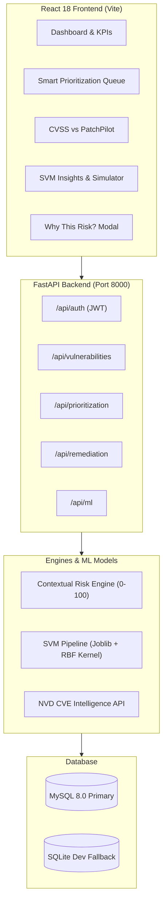

# PatchPilot — Smart Vulnerability Prioritization

[](https://www.python.org/)
[](https://fastapi.tiangolo.com/)
[](https://react.dev/)
[](https://tailwindcss.com/)
[](https://scikit-learn.org/)
[](https://www.mysql.com/)

> **A beginner-friendly, production-ready, full-stack cybersecurity web application that combines transparent contextual risk scoring with a Support Vector Machine (SVM) machine learning model to help organizations, colleges, and IT departments answer: *"Which vulnerabilities should we fix first, and why?"***

---

## 1. Project Overview

Modern universities, enterprise IT teams, and cloud developers encounter hundreds of reported Common Vulnerabilities and Exposures (CVEs) weekly. Because organizational resources, engineering staff, and maintenance windows are strictly limited, fixing every vulnerability immediately is impossible.

Traditional vulnerability scanners sort security issues strictly by their raw **CVSS (Common Vulnerability Scoring System)** base score. However, a flaw with a CVSS score of 9.8 residing on an air-gapped, isolated student lab workstation poses far less operational threat than a moderate CVSS 6.8 flaw on an internet-facing production student registration portal under active in-the-wild exploitation.

**PatchPilot** closes this critical gap by fusing:
1. **A transparent, deterministic Contextual Risk-Scoring Engine (0–100 points)** that weighs public internet exposure, asset criticality, exploit maturity, in-the-wild threat telemetry, and remediation deadlines.
2. **A Support Vector Machine (SVM) machine learning pipeline** that learns non-linear triage patterns across multi-dimensional feature vectors to independently estimate priority tiers.
3. **An interactive, explainable single-page application** tailored for college project exhibitions, faculty reviews, and security analysts.

---

## 2. Four Core Highlight Features

### 🌟 1. Smart Prioritization Queue (`/prioritization`)
The primary decision-support queue. Vulnerabilities are ranked strictly by **Contextual Risk Score** (#1, #2, #3...) rather than generic CVSS numbers. For every item, the system delivers actionable advice tailored to patch availability and threat status (e.g. *Deploy emergency vendor patch within 24-48 hours* vs. *Enforce network ACLs and WAF virtual patching*), accompanied by SLA breach warning badges.

### 🔍 2. "Why This Risk?" Explainability Modal
Every vulnerability features an instant explainability modal that answers *"Why is this prioritized?"* in plain, accessible English. It displays a visual breakdown of all 7 contributing factors:
- **CVSS Base Score**: Up to 40 points
- **Asset Criticality**: Up to 15 points
- **Internet Exposure**: Up to 10 points
- **Exploit Availability**: Up to 10 points
- **Verified Active Exploitation**: Up to 15 points
- **Vulnerability Age**: Up to 5 points
- **Overdue SLA Penalty**: Up to 5 points

### 🤖 3. SVM Machine Learning Model (`/ml-insights`)
A reproducible scikit-learn pipeline combining `StandardScaler`, `OneHotEncoder`, and `SVC(kernel='rbf', class_weight='balanced')`. Demonstrates machine learning independently from the transparent points engine with **real held-out evaluation metrics** (Accuracy: **81.67%**, Macro F1: **0.7981**), an empirical confusion matrix, and an interactive **Live SVM Inference Simulator**.

### ⚖️ 4. CVSS vs. PatchPilot Contextual Comparison (`/comparison`)
A side-by-side comparative table demonstrating how environmental context changes the remediation order. Shows original CVSS rank vs. PatchPilot rank, rank shift vectors (`+N Up` or `-N Down`), and plain-English explanations for each elevation or deprioritization.

---

## 3. Technology Stack

### Frontend
- **Framework**: React 18.2 with Vite 5.2
- **Styling**: Tailwind CSS 3.4 with dark cyber aesthetic
- **Routing**: React Router DOM v6
- **HTTP Client**: Axios with JWT interceptors
- **Visual Analytics**: Recharts 2.12
- **Icons**: Lucide React

### Backend
- **Framework**: Python 3.11+ with FastAPI 0.110+
- **ASGI Server**: Uvicorn
- **Data Validation**: Pydantic V2 & Pydantic Settings
- **ORM**: SQLAlchemy 2.0
- **Security & JWT**: Python-Jose with HS256, direct `bcrypt` password hashing (12 rounds)
- **Machine Learning**: Scikit-learn (SVM / SVC with RBF kernel), Pandas, NumPy, Joblib

### Database
- **Primary Database**: MySQL 8.0+ / MariaDB 10.5+ (`patchpilot_db`)
- **Zero-Config Development Fallback**: Automatic SQLite fallback mode (`patchpilot.db`)

---

## 4. System Architecture



---

## 5. Directory Structure

```text
PATCHPILOT1/
├── backend/
│   ├── app/
│   │   ├── api/             # REST API routers (auth, vulns, queue, ml, assets, remediation, reports)
│   │   ├── core/            # Config, security, permissions, JWT handling
│   │   ├── models/          # SQLAlchemy relational models (User, Asset, Vulnerability, History, Audit)
│   │   ├── schemas/         # Pydantic V2 validation schemas
│   │   ├── services/        # Scoring engine, vulnerability service, prioritization, ML service
│   │   ├── database.py      # Dual MySQL/SQLite connection engine
│   │   └── main.py          # FastAPI application entrypoint & startup lifecycle
│   ├── ml/
│   │   ├── models/          # Serialized SVM pipeline (.joblib) & metadata (.json)
│   │   ├── train.py         # Reproducible SVM training script
│   │   ├── predict.py       # Inference service
│   │   ├── evaluate.py      # Evaluation metrics calculator
│   │   └── dataset_validation.py # Data integrity validation
│   ├── tests/
│   │   ├── test_risk_scoring.py # 9 unit tests for scoring boundaries & formulas
│   │   └── test_api.py          # 8 end-to-end integration tests for endpoints
│   ├── seed_data.py         # Seeder for realistic demonstration assets and vulnerabilities
│   ├── requirements.txt     # Python dependencies
│   └── .env.example         # Environment template
├── frontend/
│   ├── src/
│   │   ├── api/             # Modular Axios client
│   │   ├── components/      # Sidebar, Header, RiskBadge, SeverityBadge, StatusBadge, WhyRiskModal
│   │   ├── context/         # AuthContext (JWT session management)
│   │   ├── pages/           # 11 complete application pages
│   │   ├── App.jsx          # Protected route definitions
│   │   ├── index.css        # Tailwind directives
│   │   └── main.jsx         # React DOM root
│   ├── package.json         # Node.js dependencies
│   ├── vite.config.js       # Vite build configuration
│   └── tailwind.config.js   # Tailwind theme extensions
├── database/
│   ├── schema.sql           # MySQL 8.0 DDL database creation script
│   └── README.md            # Database configuration instructions
├── datasets/
│   ├── generate_dataset.py  # Synthetic dataset generator
│   └── sample_synthetic_data.csv # 1,200 validated vulnerability records
├── docs/
│   ├── architecture.md      # Full architecture & component diagrams
│   ├── database_schema.md   # Schema ER diagram & data dictionary
│   ├── api_documentation.md # Complete REST API reference
│   ├── ml_methodology.md    # SVM mathematical formulation & evaluation
│   ├── user_guide.md        # Operations & user guide
│   └── troubleshooting.md   # Windows & VS Code troubleshooting guide
└── README.md                # Master documentation
```

---

## 6. Installation & Setup Guide (Windows / VS Code)

### Prerequisites Check
Open Windows PowerShell and verify:
```powershell
python --version   # Requires Python 3.11 or newer
node -v            # Requires Node.js v18 or v20+
npm -v             # Requires npm 9+
```

---

### Step 1: Backend Setup

1. Open PowerShell and navigate to the `backend` folder:
   ```powershell
   cd C:\Users\Admin\Desktop\PATCHPILOT1\backend
   ```

2. Create and activate a Python virtual environment:
   ```powershell
   python -m venv .venv
   .\.venv\Scripts\Activate.ps1
   ```

3. Upgrade pip and install backend dependencies:
   ```powershell
   pip install --upgrade pip
   pip install -r requirements.txt
   ```

4. Create the environment configuration:
   ```powershell
   Copy-Item .env.example .env
   ```
   *(By default, `USE_SQLITE=True` is enabled in `.env` for instant zero-configuration setup. If you wish to use MySQL, see Section 7).*

5. Train the SVM machine learning model:
   ```powershell
   python ml\train.py
   ```
   *(Output: `SVM model trained and saved successfully (Accuracy: 81.67%, F1-Macro: 0.7981)`).*

6. Seed demonstration users and institutional assets:
   ```powershell
   python seed_data.py
   ```

7. Start the FastAPI development server:
   ```powershell
   uvicorn app.main:app --reload --host 127.0.0.1 --port 8000
   ```
   - Interactive Swagger API docs: **[http://127.0.0.1:8000/docs](http://127.0.0.1:8000/docs)**
   - Health check endpoint: **[http://127.0.0.1:8000/api/health](http://127.0.0.1:8000/api/health)**

---

### Step 2: Frontend Setup

1. Open a **new, separate PowerShell terminal** and navigate to `frontend`:
   ```powershell
   cd C:\Users\Admin\Desktop\PATCHPILOT1\frontend
   ```

2. Install npm dependencies:
   ```powershell
   npm install
   ```

3. Configure frontend environment:
   ```powershell
   Copy-Item .env.example .env
   ```

4. Start Vite development server:
   ```powershell
   npm run dev
   ```
   - Open your browser to the local address printed by Vite: **[http://localhost:5173](http://localhost:5173)**

---

## 7. Public Demo Deployment (Render)

The `render.yaml` Blueprint deploys the FastAPI backend and React frontend as separate Render services.

1. Push the contents of this project folder (the folder containing `render.yaml`) to a GitHub repository. The included `.gitignore` excludes local virtual environments, dependencies, environment files, and SQLite databases.
2. In Render, choose **New → Blueprint**, connect the GitHub repository, and apply the `render.yaml` Blueprint.
3. When both services finish deploying, open the `patchpilot-ui` service's `onrender.com` URL and sign in with one of the demonstration accounts below.

This is a public **demo** setup: it uses temporary SQLite storage, so changes can be lost when the service restarts or redeploys. The demo credentials are known, so do not store real or sensitive information in this deployment. Render's free backend service may take a little time to wake up after inactivity.

---

## 8. Pre-configured Demonstration Accounts

For convenient college review and academic exhibition, two pre-configured accounts are available:

| Role | Email | Password | Permissions |
| :--- | :--- | :--- | :--- |
| **Administrator** | `admin@patchpilot.local` | `Admin@123456` | Full system control: Asset CRUD, ML retraining, CSV import/export, vulnerability deletion |
| **Security Analyst** | `analyst@patchpilot.local` | `Analyst@123456` | Triage operations: View queue, update remediation status, assign issues, log audit notes |

*(On the Login screen, click the **Administrator** or **Security Analyst** quick-fill button to populate credentials in one click).*

---

## 8. MySQL Database Configuration (Optional Production Mode)

If you have MySQL Server installed locally:
1. Log into MySQL: `mysql -u root -p`
2. Execute the schema: `source database/schema.sql;`
3. Edit `backend/.env`:
   ```env
   USE_SQLITE=False
   DB_HOST=localhost
   DB_PORT=3306
   DB_USER=root
   DB_PASSWORD=your_actual_mysql_password
   DB_NAME=patchpilot_db
   ```
4. Run `python seed_data.py`. If MySQL is ever stopped, PatchPilot will log a warning and fall back to SQLite mode automatically.

---

## 9. Automated Testing & Verification

Run the automated test suite with pytest:
```powershell
cd backend
.\.venv\Scripts\Activate.ps1
pytest tests -v
```

### Verified Test Results:
- **`tests/test_risk_scoring.py`**: **9 Passed**
  - Boundary CVSS scores (0.0 to 10.0 clamping)
  - Missing and unknown telemetry handling
  - Internet exposure point scaling
  - Verified active exploitation elevation
  - Overdue SLA penalty logic
  - Deterministic repeatability
- **`tests/test_api.py`**: **8 Passed**
  - `/api/health` operational readiness
  - Authentication & JWT token security
  - Asset CRUD flow
  - Prioritization queue descending order validation
  - CVSS vs PatchPilot rank movement calculation
  - Dashboard summary & chart aggregations
  - SVM model status and live inference prediction

**Total Test Suite Result: 17 Passed, 0 Failed.**

---

## 10. Short Project Presentation Summary (For Faculty Review)

When presenting PatchPilot to college evaluators, project reviewers, or external examiners, use this concise sequence:

1. **Problem**: Security scanners produce overwhelming volumes of CVE alerts. Prioritizing remediation solely by standard CVSS scores fails because CVSS ignores environmental context (whether the server is internet-exposed, how critical the system is, or whether exploit code is circulating).
2. **Solution**: PatchPilot introduces a dual-engine decision-support system that combines an auditable, transparent 0–100 Contextual Risk-Scoring Engine with a Support Vector Machine (SVM) classifier.
3. **Technology**: Python FastAPI backend with SQLAlchemy, MySQL 8.0/SQLite dual engine, React 18 frontend with Tailwind CSS and Recharts, and Scikit-learn for machine learning.
4. **Machine Learning Component**: An SVM classifier with a Radial Basis Function (RBF) kernel trained on 1,200 validated vulnerability records across 8 features, achieving **81.67% test accuracy** and **0.7981 macro F1-score**.
5. **Practical Usefulness**: The **Smart Prioritization Queue** provides immediate clarity on what to fix first, the **"Why This Risk?"** feature explains the score in plain English, and the **CVSS vs. PatchPilot Comparison** demonstrates how context safely deprioritizes isolated vulnerabilities while elevating critical operational threats.
6. **Limitations & Ethics**: The SVM model is a decision-support aid based on learned feature patterns, not an absolute guarantee against future attacks. It is designed to work in tandem with human security analyst verification.
